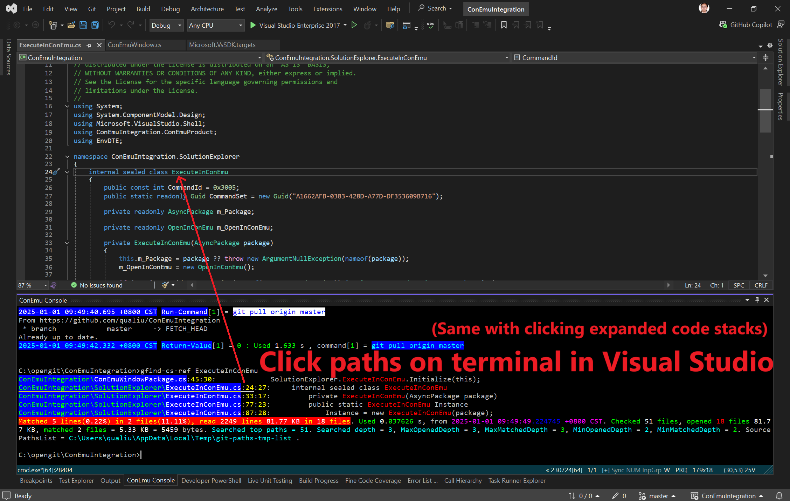

# Integrated Coding Tool + Debugging in Visual Studio (+VsCode)

Use [ConEmu terminal](https://conemu.github.io/) and [ConEmu VS extension](https://marketplace.visualstudio.com/items?itemName=DavidRoller.ConEmuIntegration2022) for `Visual Studio (like VS 2022)`.

- [Vscode](https://code.visualstudio.com/download) and [vscode-msr extension](https://marketplace.visualstudio.com/items?itemName=qualiu.vscode-msr) are **optional** (can be integrated with VS + system console/terminal).
  - See [**Why + How** to Use Custom Alias and Normal Alias](../../README.md) for more details.

## 1. Setup ConEmu Terminal with Visual Studio

### Install ConEmu Terminal + ConEmu VS Extension

- Manually install [ConEmu](https://conemu.github.io/) or run command: `winget install conemu`([built-in winget](https://learn.microsoft.com/en-us/windows/package-manager/winget/)), or `choco install conemu`(if you have [Chocolatey](https://community.chocolatey.org/packages/ConEmu)).

- Install [ConEmu VS extension](https://marketplace.visualstudio.com/items?itemName=DavidRoller.ConEmuIntegration2022) in Visual Studio (need to restart VS).

### Setup ConEmu with Visual Studio

- Clone this repository.
- Run the setup tool from PowerShell 7, using your existing repository path:

  ```powershell
  & 'C:\opengit\msrTools\code\vs-conemu\Setup-ConEmu-VisualStudio.ps1'
  ```

  It prepares per-user Edge associations for `.html`, `.htm`, `.md`, `.markdown`, `.xml`, `.log`, `.json`, and `.txt` before configuring ConEmu.
  Each association must report `WindowsVerified=True`: the helper checks the effective Windows Shell ProgID and executable, as well as the UserChoice hash.
  This prevents a first-open application chooser caused by a missing association, including clicks ConEmu handles directly through ShellExecute.
  A locally matching hash alone is not proof Windows accepts the association. A failed verification preserves the previous association and stops setup.
  Use `-DefaultFileProgId <registered-ProgID>` for another application, or `-SkipFileAssociations` to change only ConEmu settings.
  The click callback still prefers a running Visual Studio; otherwise it uses the file's default application.

- To apply only the click callback to a running ConEmu window, use the command below in CMD (replace the repository path first).
  This macro alone does not prepare file associations:
  - **ConEmuC -GuiMacro SetOption FarGotoEditorPath** `"PowerShell -NoProfile -ExecutionPolicy Bypass -NoLogo -WindowStyle Hidden -File` **`C:\opengit\msrTools\`**[code\vs-conemu\Open-ClickedPathRow-in-VisualStudio.ps1](./Open-ClickedPathRow-in-VisualStudio.ps1) `\"%1\" \"%2\" \"%3\""`
    - If failed due to not found `ConEmuC`: Run [add-user-path](https://marketplace.visualstudio.com/items?itemName=qualiu.vscode-msr#additional-tips) `"C:\Program Files\ConEmu\ConEmu"` then re-run above command.
- Follow [this **screenshot**](./images/init-setup-conemu-in-vs.png) to setup ConEmu with Visual Studio.
  - You can also run command alias [setup-vs-conemu](https://github.com/qualiu/msrTools/blob/master/code/vs-conemu/vscode/settings.json#L3-L7) if you done alias step below.
- Optional: Use [**normal + custom alias**](https://marketplace.visualstudio.com/items?itemName=qualiu.vscode-msr#custom-alias-to-auto-sync-across-local-and-remote-ssh-hosts-plus-docker-containers) (like [**gfind-cs-pref**](https://github.com/qualiu/msrTools/blob/master/code/vs-conemu/vscode/settings.json#L8-L12)) to help **general** code mining + file processing in System + Vscode + Visual Studio.

## 2. Use ConEmu Terminal in Visual Studio

### Advanced code mining in Visual Studio with Clickable Code Paths

- Example: Search all references in whole repository (not just solution scope of current *.sln) + filter output all junk results (tests + definitions):
  - [**gfind-cs-pref**](https://github.com/qualiu/msrTools/blob/master/code/vs-conemu/vscode/settings.json#L8-L12) `ExecuteInConEmu`
    - You can [add more args](https://marketplace.visualstudio.com/items?itemName=qualiu.vscode-msr#search-files-with-rich-filters) like below - the **more** args, the **faster** searching speed:
      - gfind-cs-pref `ExecuteInConEmu` **--xp** `Tool,test,/unit`
      - gfind-cs-pref `ExecuteInConEmu` **--sp** `/ConEmu,Integration`



## Troubleshooting local file links

If an alias targets a directory but was created as a **file symbolic link**, Windows file reads may work through it while directory navigation and shell opening fail.
Check the link itself with `Get-Item -Force`: `LinkType=SymbolicLink` alone does not distinguish file and directory links. A correct directory link has the
`Directory` attribute and `PSIsContainer=True`; a mistyped file link can instead report `FileInfo`, `Archive, ReparsePoint`, and `Directory.Exists=False`.
`Get-ChildItem` may return that link itself instead of its contents, and `Set-Location` may fail even when a nested file is readable.

A controlled test on Windows 11 build 26100, using the same Markdown file and Edge association, produced:

| Path parent | Forward slashes | Backslashes |
|---|---|---|
| Normal directory | Shell open succeeds | Shell open succeeds |
| File symbolic link targeting a directory | `ShellExecute` error 2 | Shell open succeeds |
| Directory symbolic link targeting that same directory | Shell open succeeds | Shell open succeeds |

Slash direction exposes this link-type problem; forward slashes are not inherently broken. Repair the alias after confirming the type mismatch:

1. Record its exact target and a representative file's SHA-256. Confirm that the target exists and is a directory.
2. Create a temporary sibling directory symbolic link to that same target with `New-Item -ItemType SymbolicLink`. Require `PSIsContainer=True`, the `Directory`
   attribute, and the same target/file identity before activating it. A directory junction is another option for supported local targets.
3. Rename the original link to a unique backup name, then rename the verified replacement to the original alias name. Restore the backup name if activation fails.
   These operations affect only the links: never recursively delete or move the target directory.
4. Verify that `dir` lists contents, `cd` succeeds, the target and file hash are unchanged, and shell opening works with both slash forms. Keep the old link backup
   until validation completes. A successful backslash path alone is only a workaround.

When creating directory aliases, validate the resulting directory attribute immediately; a successful link-creation call or readable child file is not sufficient.

ConEmu 230724 can classify a drive path with forward slashes as a URL. That branch passes the text directly to Windows `ShellExecute` and reports **URL open failed**
on failure; it does not call `Open-ClickedPathRow-in-VisualStudio.ps1` or use `FarGotoEditorPath`. Changing the editor script or resetting a valid default application
does not repair a mistyped link. `File.Exists` and `FindExecutable` alone are insufficient to verify shell opening. Compare link metadata across machines before
attributing different results to ConEmu, Edge, or Windows versions.

Sources for version 230724: [URL classification](https://github.com/Maximus5/ConEmu/blob/v23.07.24/src/ConEmu/Match.cpp) and
[URL/editor dispatch](https://github.com/Maximus5/ConEmu/blob/v23.07.24/src/ConEmu/RealBuffer.cpp), function `CRealBuffer::ProcessFarHyperlink`.
